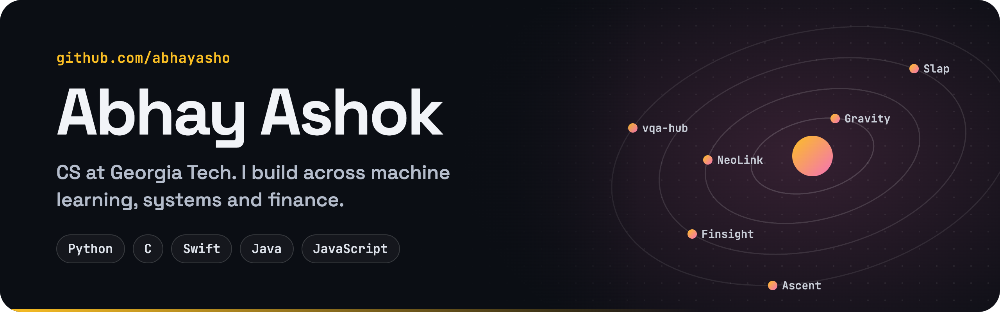

  

# Hi! I'm Abhay 👋

I'm a Computer Science student at **Georgia Tech** exploring the intersection of **machine learning, systems and finance**. I love building intelligent tools, from ML-accelerated simulations to embedded systems and trading research.

  
  
  
  
  
  
  
  
  

## Projects

<table>
  <tr>
    <td width="50%" valign="top">
      
      <b><a href="https://github.com/abhayasho/Gravity">Gravity</a></b>: a WebGL view of Earth and the thousands of objects orbiting it.
    </td>
    <td width="50%" valign="top">
      
      <b><a href="https://github.com/abhayasho/NeoLink">NeoLink</a></b>: a native macOS terminal with tabbed SSH sessions and an SFTP browser.
    </td>
  </tr>
  <tr>
    <td width="50%" valign="top">
      
      <b><a href="https://github.com/abhayasho/Slap">Slap</a></b>: double-tap or triple-tap your MacBook to run shortcuts, using its accelerometer.
    </td>
    <td width="50%" valign="top">
      
      <b><a href="https://github.com/abhayasho/Finsight">Finsight</a></b>: grades stocks on fundamentals, momentum and FinBERT news sentiment.
    </td>
  </tr>
  <tr>
    <td width="50%" valign="top">
      
      <b><a href="https://github.com/abhayasho/vqa-hub">VQA Hub</a></b>: research on routing small vision and language models for visual question answering.
    </td>
    <td width="50%" valign="top">
      
      <b><a href="https://github.com/abhayasho/AscentGBA">Ascent</a></b>: a six-floor dungeon adventure for the Game Boy Advance, written in C.
    </td>
  </tr>
  <tr>
    <td width="50%" valign="top">
      
      <b><a href="https://github.com/abhayasho/Lyra">Lyra</a></b>: a wake-word voice assistant with a local LLM and an ElevenLabs voice.
    </td>
    <td width="50%" valign="top">
      
      <b><a href="https://github.com/abhayasho/SpotifyWrappedApp">Wrapped</a></b>: your Spotify top songs, artists and genres on Android, any time of year.
    </td>
  </tr>
  <tr>
    <td width="50%" valign="top">
      
      <b><a href="https://github.com/abhayasho/SchedulerApp">Scheduler</a></b>: an Android student planner with a to-do list and an exam tracker.
    </td>
    <td width="50%" valign="top">
      
      <b><a href="https://github.com/abhayasho/AnkiExtraDrive">AnkiExtraDrive</a></b>: a planned BLE-to-WebSocket bridge for Anki Overdrive cars.
    </td>
  </tr>
</table>

> Corporate projects and work are private.

## Reach out to me!

📫 aashok45@gatech.edu 
🔗 [LinkedIn](https://www.linkedin.com/in/abhay-ashok/)
